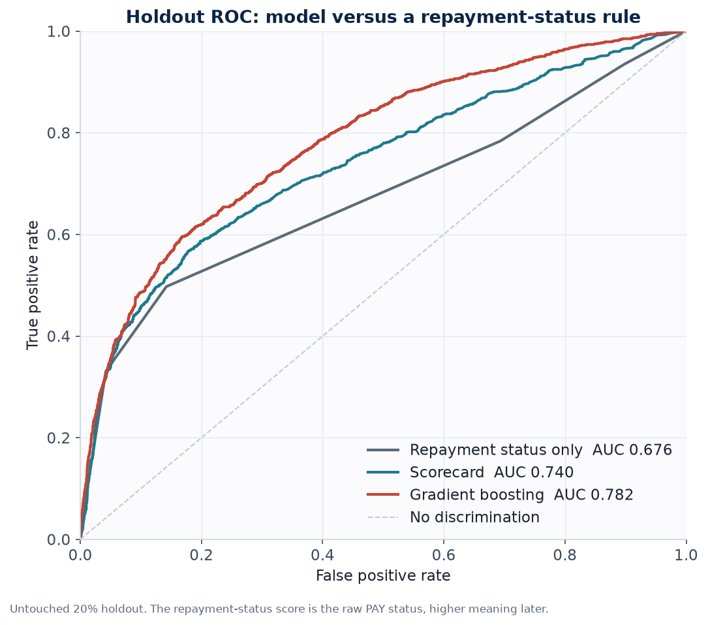
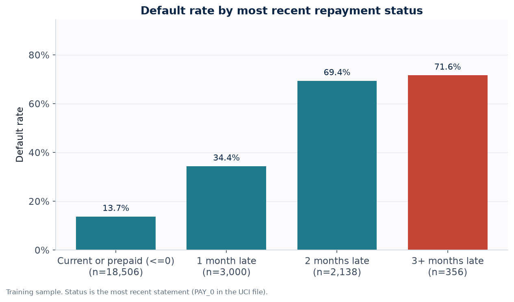
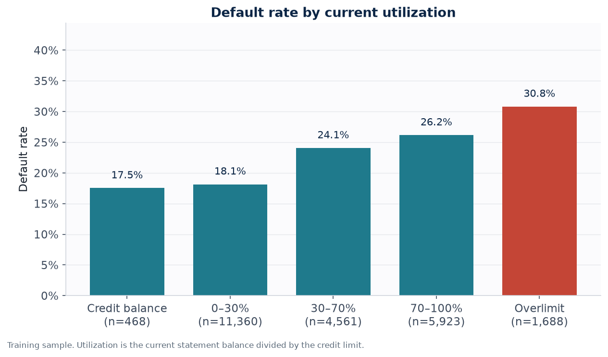
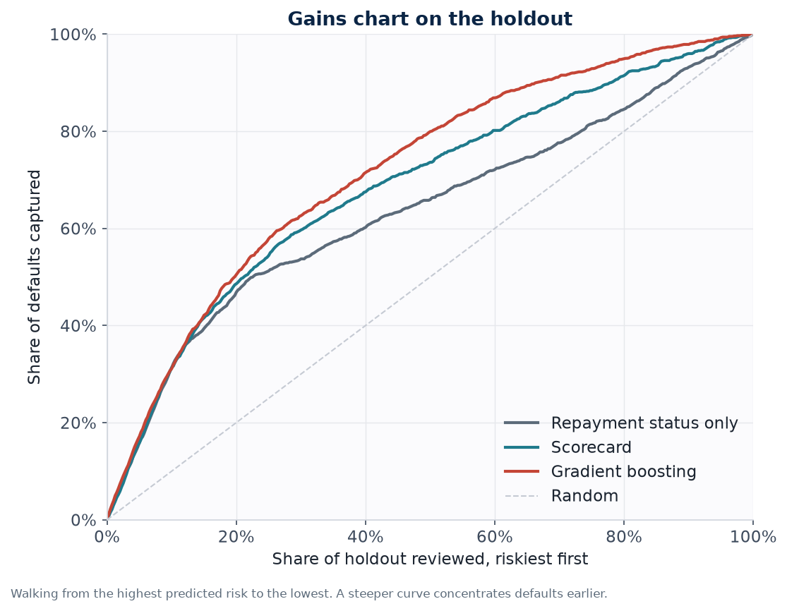
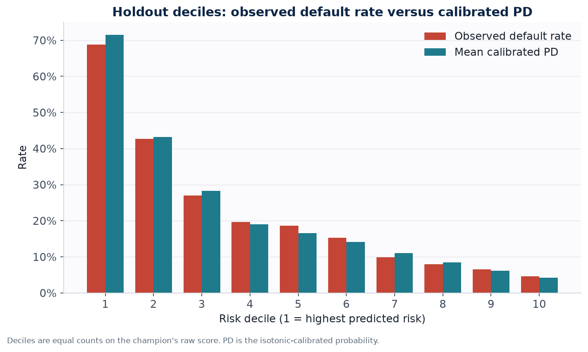
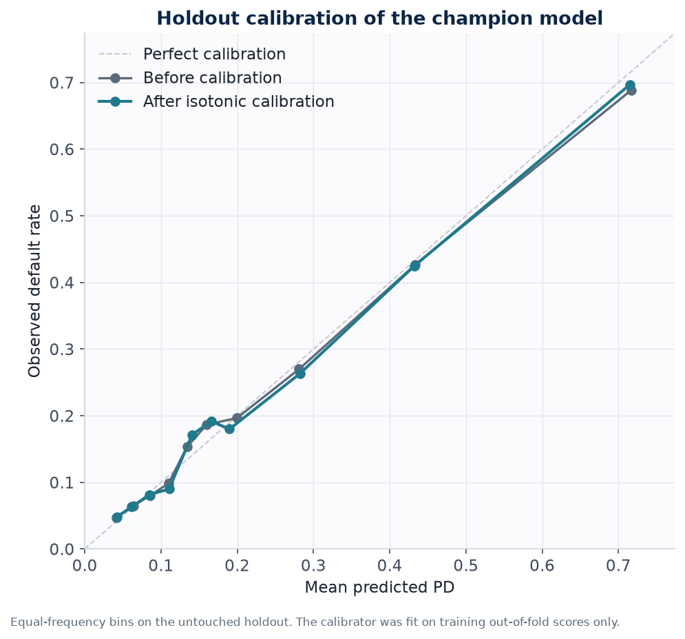
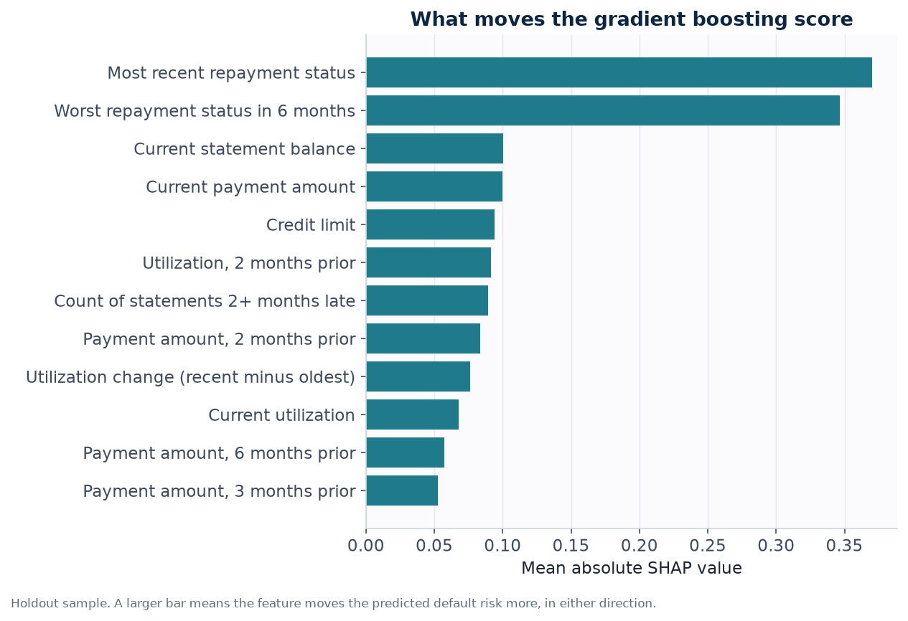
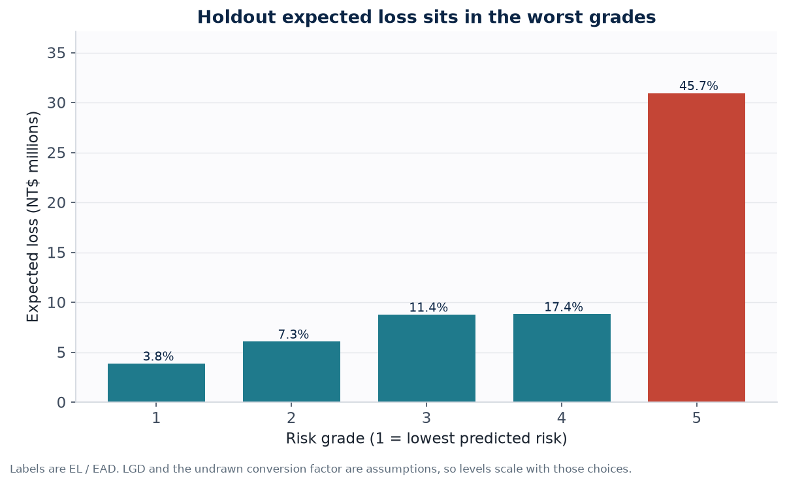
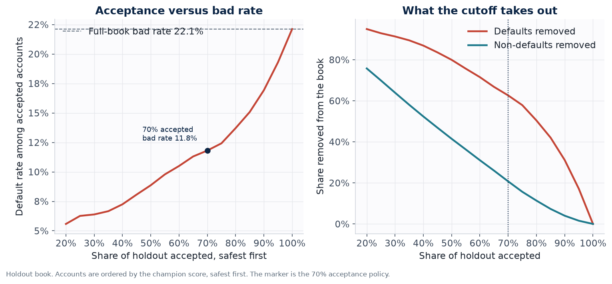

# Credit default risk and expected loss

**Tanner Allred** · Houston
Behavioral probability-of-default model and expected-loss view of a retail credit-card book.
Python, SQL, and a scorecard a credit committee can read.

The question is the one a portfolio analyst gets after the monthly tape lands: which accounts are likely to default next month, what loss that implies, and what happens to the bad rate if the book is cut at a chosen risk threshold.

This is a **behavioral** PD. Every account already has six statement months. A brand-new applicant would not have that history, so the same specification is not an origination scorecard. The target is default in the following month. Amounts are New Taiwan dollars, the unit of the source file.

## Result

On a stratified 20% holdout (6,000 accounts, seed 42):

| Model | AUC | Gini | KS |
| --- | ---: | ---: | ---: |
| Repayment status alone | 0.676 | 0.352 | 0.355 |
| Logistic scorecard (WOE) | 0.740 | 0.479 | 0.389 |
| Gradient boosting, the decision model | **0.782** | **0.565** | **0.428** |

KS is on the 0–1 scale (0.428 is about 43 KS points).

Accepting the safest **70%** of that holdout cuts the bad rate from **22.1%** to **11.8%**. That cut removes **62.6%** of defaults and **20.7%** of accounts that do not default. Under an illustrative loss given default of 75% and a 10% conversion factor on undrawn limit, expected loss on the holdout is **NT$58.5 million** on **NT$380.7 million** of exposure (15.4% of EAD). The worst fifth of accounts holds **52.9%** of that expected loss.



## The book

Source: UCI Machine Learning Repository, *Default of Credit Card Clients* (Yeh and Lien, 2009). 30,000 Taiwanese credit-card accounts. Statement history runs April–September 2005; the label is default the next month. The workbook is downloaded by `scripts/download_data.py` and is not committed. A 250-row stratified excerpt is in `data/sample/` so the column layout is visible without a download.

| | |
| --- | ---: |
| Accounts | 30,000 |
| Defaults | 6,636 |
| Default rate | 22.12% |
| Average limit | NT$167,484 |
| Average positive balance | NT$56,105 |
| Average utilization | 42.4% |
| Median limit, no default | NT$150,000 |
| Median limit, default | NT$90,000 |

Cleaning left the row count unchanged: no nulls in the modeling fields, no duplicate account ids, no non-positive limits. Undocumented education codes 0, 5, and 6 (345 accounts) and marriage code 0 (54 accounts) are folded into the published "other" level. The UCI file labels the latest repayment status `PAY_0` and then skips to `PAY_2`. `PAY_0` is renamed `pay_1` so it lines up with the latest bill.

Recent delinquency dominates the raw default rate (training sample):



| Most recent status | Accounts | Default rate |
| --- | ---: | ---: |
| Current or prepaid | 18,506 | 13.7% |
| 1 month late | 3,000 | 34.4% |
| 2 months late | 2,138 | 69.4% |
| 3+ months late | 356 | 71.6% |

Utilization moves the same direction, and the slope is much flatter: 18.1% default in the 0–30% band, 30.8% when the balance is over the limit. A utilization-only score has holdout AUC 0.535. Delinquency is the spine of the model. Limit, balance, and payment amount are the supporting cast.



## Approach

The protocol is fixed in `src/credit_risk/config.py` and is not searched on the holdout.

- Stratified 80/20 split, seed 42 (24,000 / 6,000). Default rates match (22.12% in both).
- Five-fold stratified cross-validation on the training set. Weight of evidence is refit inside each fold.
- **Scorecard.** Domain bins for repayment status, months late, utilization, payment ratio, age, and education. Quantile bins for the limit. WOE is ln(share of non-defaults / share of defaults). L2 logistic regression. A characteristic with information value under 0.02 is screened out. A coefficient with the wrong sign (a safer bin treated as riskier) is dropped and the regression is refit. Points use a points-to-double-odds scale: 20 points doubles the odds of non-default, and a score of 600 would correspond to 20:1 odds. On this book the intercept lands at 549.8 points, because a 22% default rate is a long way from 20:1 odds.
- **Gradient boosting.** XGBoost on the statement history, utilization, payment ratios, and delinquency summaries. Median imputation is fit on the training rows only.
- **Class imbalance.** The default rate is 22%, which is uneven and not rare. A balanced-weight variant is kept only if it lifts that family's training AUC by at least 0.005. It did not (scorecard 0.758 either way; boosting 0.787 either way), so both models stay unweighted. Unweighted probabilities are what expected loss needs.
- **Calibration.** Isotonic regression is fit on out-of-fold training scores and applied to the refit model. Expected loss uses the calibrated PD.
- **Champion rule.** Boosting is the decision model only if its training AUC beats the scorecard by at least 0.005. The gap was 0.787 versus 0.758, so boosting decides the cutoff and the loss numbers. The scorecard stays as the transparent benchmark and as a second set of reason codes.
- **Sex and marital status are excluded from both models.** They are used only in the monitoring tables.

Information value on the training sample:

| Characteristic | IV | Read |
| --- | ---: | --- |
| Most recent repayment status | 0.87 | Very strong |
| Months late out of six | 0.86 | Very strong |
| Credit limit | 0.17 | Medium |
| Current payment / bill | 0.14 | Medium |
| Current utilization | 0.06 | Weak |
| Education | 0.04 | Weak |
| Age | 0.02 | Weak, just over the screen |

The two delinquency characteristics correlate at 0.63. Both kept a negative coefficient, which is the sign the WOE coding requires, so both stayed in the scorecard. L2 is doing the work of keeping them from flipping each other.

A current or prepaid status is worth **+9.8 points**. Two months late is worth **−35.1 points**. Three or more months late is worth **−36.9 points**. The full points table is `reports/tables/scorecard.csv` and the `Scorecard` sheet of `reports/CreditRiskPortfolio.xlsx`.

## Holdout performance

Training CV AUC for boosting ran from 0.778 to 0.793 across the five folds (mean 0.787, standard deviation 0.006). The holdout came in at 0.782. The scorecard's CV mean was 0.758 and its holdout was 0.740, so it gave up a little more out of sample. Population stability of the out-of-fold scores against the holdout is 0.003 for boosting and 0.007 for the scorecard. Both sit in the usual "stable" range, which is what a random split should do.



Reviewing the riskiest 30% of the holdout captures **62.6%** of defaults with boosting and **53.7%** with the repayment-status rule. The riskiest tenth has a 68.8% default rate; the safest tenth has 4.7%. The observed default rate falls in every decile.



| Decile (1 = riskiest) | Observed default rate | Mean calibrated PD |
| --- | ---: | ---: |
| 1 | 68.8% | 71.5% |
| 2 | 42.7% | 43.3% |
| 3 | 27.0% | 28.2% |
| 5 | 18.7% | 16.6% |
| 10 | 4.7% | 4.2% |

The unweighted boosting model was already close to the diagonal. Holdout ECE is 0.012 before isotonic calibration and 0.014 after. Brier score is 0.135, against 0.172 for a constant prediction at the training default rate. Book-level mean calibrated PD is **22.25%** against an observed holdout default rate of **22.12%**. Expected loss still uses the calibrated PD, because that was the rule set before the holdout was scored. The practical difference is small.



SHAP on a holdout sample puts almost all of the movement on two delinquency fields: the latest repayment status and the worst status in the six-month window. Balance, payment amount, limit, and utilization follow. Education and age are in the model and rank well down the list.



## Expected loss

\[
\mathrm{EL} = \mathrm{PD} \times \mathrm{LGD} \times \mathrm{EAD}
\]

\[
\mathrm{EAD} = \max(\text{statement balance}, 0) + 0.10 \times \max(\text{limit} - \text{drawn}, 0)
\]

There are no recoveries and no balance-at-default history in this file. LGD and the conversion factor are assumptions, applied uniformly, so they scale the dollar loss and do not change who ranks as risky. The primary case uses **LGD = 75%**, a high unsecured-card severity. A 45% case is reported beside it. A negative statement balance is treated as zero drawn exposure.

| | Accounts | Observed default rate | Mean PD | EAD | Expected loss | EL / EAD |
| --- | ---: | ---: | ---: | ---: | ---: | ---: |
| Full holdout | 6,000 | 22.1% | 22.3% | NT$380.7m | NT$58.5m | 15.4% |
| Current or prepaid | 4,676 | 14.3% | 13.9% | NT$306.9m | NT$26.8m | 8.7% |
| Already late | 1,324 | 49.8% | 51.6% | NT$73.7m | NT$31.6m | 42.9% |
| Same book at 45% LGD | 6,000 | 22.1% | 22.3% | NT$380.7m | NT$35.1m | 9.2% |

The 15.4% headline is a behavioral book that already contains accounts two and three months late. It is not a prime origination loss rate. Splitting current from already-late is the comparison that belongs in a committee pack. Mean PD tracks the observed default rate in both slices (13.9% vs 14.3%, and 51.6% vs 49.8%).

Grades are equal-count fifths of the holdout, grade 1 safest. Labels on the chart are EL / EAD.



| Grade | Observed default rate | Mean PD | EL / EAD | Share of EL |
| --- | ---: | ---: | ---: | ---: |
| 1 | 5.6% | 5.2% | 3.8% | 6.6% |
| 2 | 8.9% | 9.8% | 7.3% | 10.4% |
| 3 | 17.0% | 15.3% | 11.4% | 15.0% |
| 4 | 23.3% | 23.6% | 17.4% | 15.1% |
| 5 | 55.8% | 57.4% | 45.7% | 52.9% |

Grade 5 is a fifth of the accounts and just over half the expected loss. Grades 1 and 5 are within about two points of their mean PD. Grade 3 is a little low on PD relative to the outcome (15.3% vs 17.0%).

## Approval cutoff

Accounts are ordered by the boosting score, safest first. The threshold column is the highest calibrated PD still accepted. Isotonic calibration ties some probabilities, which is why the 50% and 60% rows share a 16.6% PD threshold: inside that plateau the raw score still separates them, and the bad rate keeps falling as fewer accounts are accepted.



| Accepted | Bad rate | Defaults removed | Non-defaults removed | EL / EAD accepted |
| --- | ---: | ---: | ---: | ---: |
| 50% | 8.9% | 80.0% | 41.5% | 6.3% |
| 60% | 10.5% | 71.5% | 31.1% | 7.1% |
| **70%** | **11.8%** | **62.6%** | **20.7%** | **7.8%** |
| 80% | 13.7% | 50.4% | 11.4% | 8.8% |
| 90% | 16.9% | 31.1% | 4.0% | 10.6% |
| 100% | 22.1% | — | — | 15.4% |

The 70% row is a policy illustration, not a profit-maximizing cutoff. This file has no margin, fee, or cost of funds, so there is nothing honest to optimize against. The curve is the tradeoff a risk manager would take into that pricing conversation.

## Fairness monitoring and adverse action

Sex and marital status are not inputs. Approval rates are still computed at the same 70% cutoff, because limit, utilization, and delinquency can proxy for a characteristic the model never sees.

| Group | Accounts | Approval rate | Bad rate if approved |
| --- | ---: | ---: | ---: |
| Female | 3,598 | 71.3% | 11.2% |
| Male | 2,402 | 68.0% | 12.8% |

The male/female approval ratio is **0.95**. Marital status is similarly tight: the lowest group is **0.98** of the highest. Age is an input. Applicants 21–25 are approved at 60.0%, against 74.0% for ages 26–35 (ratio 0.81). Ages 56+ are approved at 64.6%. Under U.S. Regulation B, age in an empirically derived credit system has its own rules, and a lower approval rate for older applicants is something a compliance review would look at before this specification went near a decision.

Education is a weak input (IV 0.04) and the monitoring ratio looks worse than it is. High school is approved at 66.0% and the small "Other" bin at 93.9% (82 holdout accounts), a ratio of **0.70**. High school versus graduate school is 66.0% / 75.0% = **0.88**. "Other" mixes the documented other level with 345 undocumented codes whose default rate in the raw file is not the same as a real education category (code 0 has 14 accounts and zero defaults). The scorecard gives that bin a large point bonus. A model review would collapse or drop it before anyone quoted the points.

The lowest-to-highest approval ratio is a screening statistic in the spirit of the four-fifths rule of thumb. A fair-lending determination under ECOA and Regulation B is a separate legal analysis. This repository is a research-style read of a 2005 Taiwanese public file.

Because boosting is the decision model, the reasons that match the decision are the SHAP contributions. The scorecard points are shown beside them so a reviewer can see whether the transparent model tells the same story.

Highest-risk decline in the holdout, account 16555. Calibrated PD **83.7%**. Scorecard **485** points.

- Scorecard: repayment status is 3+ months late; six-month history is 3+ months late; limit is in the NT$10,000–50,000 band; no payment on the current bill.
- SHAP, same account: latest status 3, worst status in six months is 7, all six statements are 2+ months late, current balance NT$2,300.

A marginal decline, account 12970, sits on the 70% threshold at PD **23.0%** and 550 points. Both explanations point at a recent delinquency and high utilization on a small limit: the scorecard cites one month late in the history, the low limit band, and utilization of 70–100%; SHAP cites a worst status of 2, utilization of 0.98, and a NT$50,000 limit.

More examples are in `reports/tables/adverse_action_examples.csv`. A production adverse-action notice has content and timing requirements this demo does not implement. Reason codes should come from the model that actually made the decision.

## SQL

`sql/portfolio_queries.sql` is a set of named queries a credit analyst would keep next to the model: a portfolio snapshot, default rate by repayment status, utilization, education, and age, a behavior segment, a delinquent-balance watchlist, and expected loss by grade. `src/credit_risk/sql_analysis.py` loads the cleaned book and the scored holdout into SQLite and runs them. One segment cut on the full 30,000:

| Segment | Accounts | Default rate | Avg utilization |
| --- | ---: | ---: | ---: |
| Current, utilization under 70% | 16,216 | 13.0% | 18.2% |
| Current but highly utilized | 6,966 | 15.7% | 94.1% |
| 1 month late | 3,688 | 34.0% | 32.3% |
| 2+ months late | 3,130 | 69.6% | 64.2% |

High utilization among accounts that are still current lifts the default rate only from 13.0% to 15.7%. Being two or more months late lifts it to 69.6%. That is the same story as the model, told in SQL.

The grade rollup from the scored holdout is `sql_expected_loss_by_risk_grade` and matches the table above, including the result that the top grade holds 52.9% of expected loss.

## How to run

Python 3.10 or newer.

```bash
python -m venv .venv
source .venv/bin/activate
pip install -r requirements.txt
python scripts/download_data.py
python scripts/run_analysis.py
python -m pytest
python -m jupyter nbconvert --to notebook --execute --inplace notebooks/credit_default_analysis.ipynb
```

`xlrd==1.2.0` is pinned because the UCI file is a legacy `.xls`. The download script reads it with xlrd directly. Pandas is only asked to read the CSV written after that conversion.

The executed walkthrough is `notebooks/credit_default_analysis.ipynb`. Figures land in `reports/figures/`, tables in `reports/tables/`, headline numbers in `reports/metrics.json`, and a committee workbook in `reports/CreditRiskPortfolio.xlsx` (Summary, scorecard points, deciles, grades, cutoff, fairness, adverse-action examples).

## Layout

```
src/credit_risk/     data, WOE scorecard, boosting, metrics, EL, SHAP, SQL
sql/                 portfolio queries run in SQLite
scripts/             download and the batch run
notebooks/           executed walkthrough
tests/               metrics, EL, scorecard, fairness, SQL
reports/             figures, tables, metrics.json, Excel pack
data/sample/         250-row excerpt of the source file
```

## Skills this is meant to show

- **Credit.** PD, WOE and information value, a points scorecard, AUC / KS / Gini, deciles, calibration, PSI, and EL = PD × LGD × EAD. The same product is frequency × severity × exposure in an insurance reserving conversation.
- **Judgment about probabilities.** Class weights were measured and set aside because they did not improve rank-ordering, and because expected loss needs a probability at the book default rate.
- **Python.** pandas, scikit-learn, XGBoost, SHAP, a tested package rather than a one-off script.
- **SQL.** Portfolio snapshot, segment default rates, a watchlist, and a grade-level loss rollup.
- **Excel.** `CreditRiskPortfolio.xlsx` is the pack you would hand someone who lives in a workbook. The same grade and cutoff aggregates are what a Power BI portfolio page would sit on.
- **Monitoring.** Approval rates by sex, marital status, age, and education, with reason codes for a decline.

## Limitations

- One cross-section from a Taiwanese issuer in 2005. There is no out-of-time sample. A random holdout does not stand in for the next vintage.
- LGD and the undrawn conversion factor are assumptions. Quote the EL rate only next to those assumptions. At 45% LGD the holdout EL rate is 9.2% instead of 15.4%.
- Repayment history would not exist for a new-to-bank applicant. Using this model at origination would be a specification error.
- Age and education remain in the model. Both are weak. The undocumented education codes make the "other" bin look safer than a policy should trust.
- No macroeconomic overlay, no vintage curves, no reject inference, and no cost of funds. The cutoff curve stops where those inputs would start.
- SHAP reasons are explanations of this model. They are not, by themselves, an adverse-action notice.

## Citation

Yeh, I-Cheng, and Che-hui Lien. 2009. "The comparisons of data mining techniques for the predictive accuracy of probability of default of credit card clients." *Expert Systems with Applications* 36 (2): 2473–2480.

UCI Machine Learning Repository, Default of Credit Card Clients, CC BY 4.0.
The numbers in this README are the seed-42 run written to `reports/metrics.json`.
